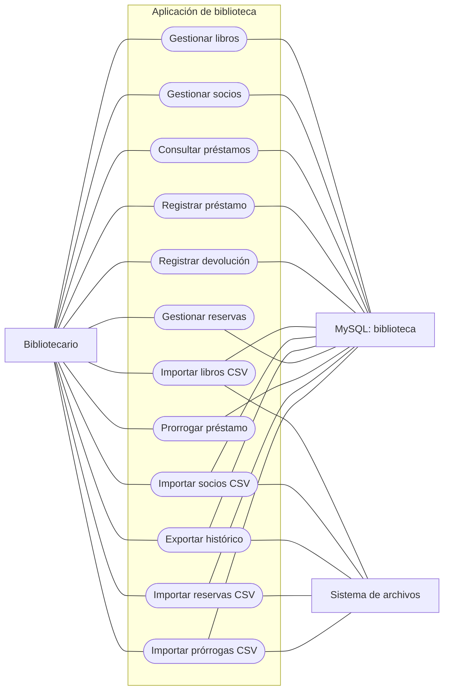
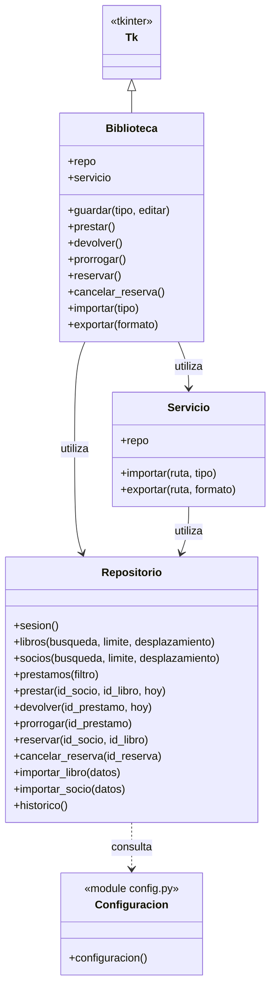
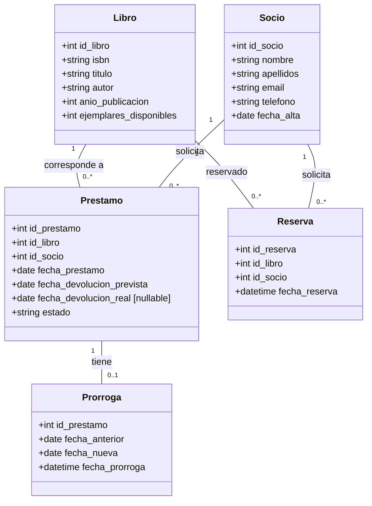
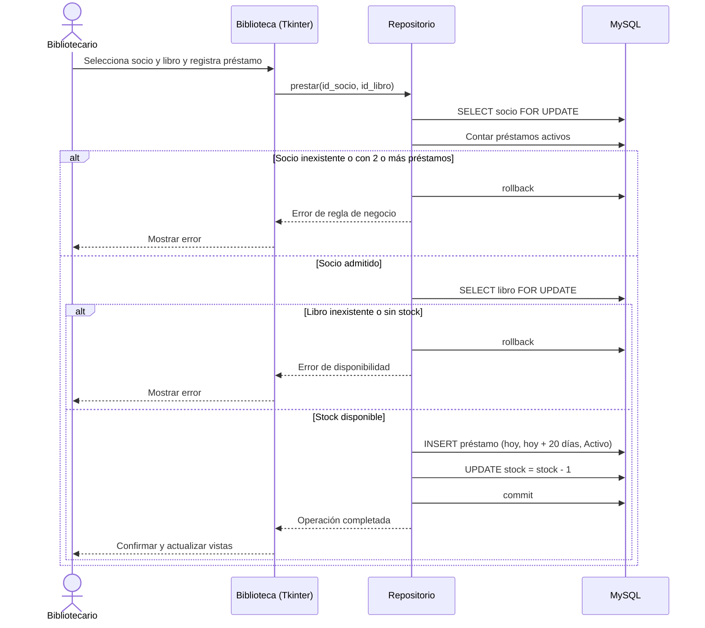
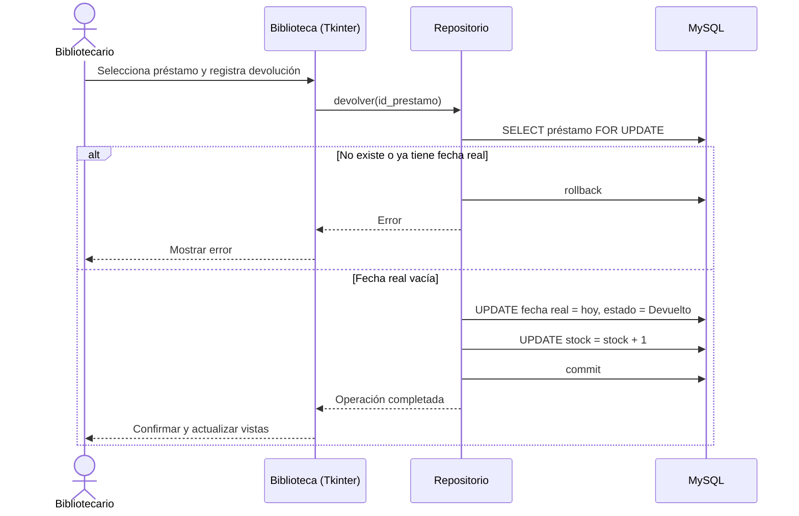
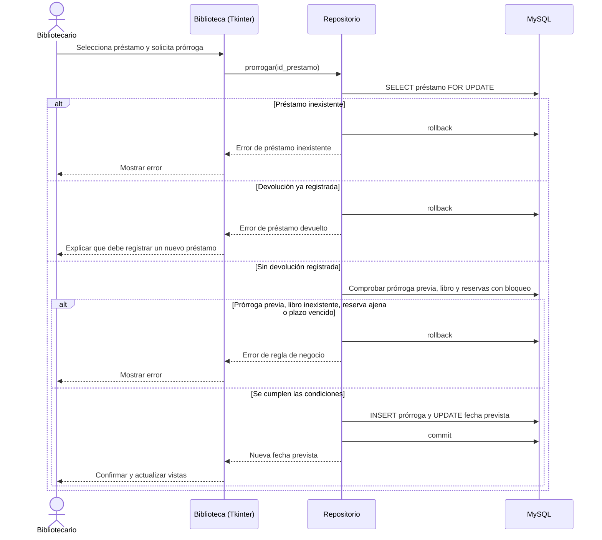

# Casos de uso y diagramas UML

Este documento describe el comportamiento actual de la aplicación. La [especificación de requisitos](especificacion_requisitos.md) contiene las reglas y el esquema de datos; el [README](../README.md) explica cómo ejecutarla y [pruebas.md](pruebas.md) detalla las comprobaciones automáticas y manuales.

## 1. Actores y condiciones generales

- **Bibliotecario:** persona que utiliza la interfaz de escritorio. La aplicación no implementa autenticación ni roles.
- **MySQL:** sistema externo que almacena libros, socios, préstamos, reservas y prórrogas. Las tablas deben existir previamente y utilizar InnoDB.
- **Sistema de archivos:** origen de los CSV de importación y destino de las exportaciones.

En los casos que requieren MySQL, la conexión debe estar configurada y el servidor disponible. Los errores se comunican mediante mensajes; las operaciones transaccionales fallidas se revierten. Las operaciones de ficheros pueden cancelarse en el diálogo de selección.

## 2. Diagrama de casos de uso

Representación simplificada del diagrama de casos de uso en Mermaid: los rectángulos externos representan actores y las figuras redondeadas, casos de uso. No requiere PlantUML ni `plantuml.jar`.

## 3. Descripción de los casos de uso

### CU-01. Gestionar libros

**Actor:** bibliotecario. **Requisitos:** RF-01, RF-04 y RN-04.

**Flujo principal:**
1. Abre la pestaña Libros y consulta los registros, en páginas de hasta 15.
2. Opcionalmente busca por título, autor o ISBN; el resultado se actualiza al escribir.
3. Introduce los datos y pulsa Crear; o selecciona una fila y pulsa Editar o Eliminar.
4. La aplicación valida los datos al crear o editar; para eliminar solicita confirmación.
5. Guarda el cambio, muestra un mensaje y actualiza las vistas. Limpiar vacía el formulario.

**Alternativas:** datos inválidos o errores de MySQL producen un mensaje; las claves foráneas pueden impedir eliminar libros con préstamos asociados. Cancelar la confirmación no elimina el registro.

**Resultado:** el libro se crea, modifica o elimina si la operación se completa correctamente. Los ejemplares introducidos representan el stock disponible.

### CU-02. Gestionar socios

**Actor:** bibliotecario. **Requisitos:** RF-02, RF-04 y RN-04.

**Flujo principal:**
1. Abre Socios y consulta los registros, en páginas de hasta 15.
2. Opcionalmente busca por nombre, apellidos o email.
3. Introduce los datos para crear un socio, o selecciona uno para editarlo o eliminarlo.
4. La aplicación valida los datos o solicita confirmación de eliminación, según la operación.
5. Guarda el cambio y actualiza las vistas. El formulario nuevo propone la fecha de hoy.

**Alternativas:** los datos inválidos, los fallos de MySQL o una restricción de clave foránea se notifican. Cancelar la confirmación no elimina el socio.

**Resultado:** el socio se crea, modifica o elimina si la operación se completa correctamente.

### CU-03. Consultar préstamos

**Actor:** bibliotecario. **Requisito:** RF-04.

**Flujo principal:**
1. Abre Préstamos y devoluciones.
2. Selecciona «Todos», «Solo Activos» o «Devueltos».
3. La aplicación muestra el resultado por ID ascendente, sin paginación.

**Regla de filtro:** activo significa `estado = 'Activo' OR fecha_devolucion_real IS NULL`; el filtro de devueltos requiere estado distinto de `Activo` y fecha real informada. El botón Actualizar vuelve a consultar la base.

**Resultado:** se visualizan los registros coincidentes, sin modificar datos.

### CU-04. Registrar préstamo

**Actor:** bibliotecario. **Requisitos:** RF-03, RN-01, RN-02 y RN-03.

**Precondiciones:** existe el socio y el libro tiene ejemplares disponibles.

**Flujo principal:**
1. Selecciona un socio y un libro disponible y pulsa Registrar préstamo.
2. La aplicación bloquea el socio y comprueba que tenga menos de dos préstamos activos.
3. Bloquea el libro y verifica de nuevo que haya stock.
4. Inserta el préstamo con fecha de hoy, vencimiento a los 20 días, fecha real vacía y estado `Activo`.
5. Resta un ejemplar disponible y confirma ambas operaciones en la misma transacción.
6. Muestra la confirmación y actualiza las vistas.

**Alternativas:** selección incompleta, socio inexistente, límite alcanzado, falta de stock o error de MySQL producen un mensaje; si la transacción falla, se revierte.

**Resultado:** existe un préstamo activo y el stock disponible del libro disminuye en uno.

**Verificación:** casos P-01 a P-05 del [documento de pruebas](pruebas.md) y comprobación manual de préstamos.

### CU-05. Registrar devolución

**Actor:** bibliotecario. **Requisitos:** RF-03 y RN-03.

**Precondición:** existe el préstamo seleccionado y su fecha real de devolución está vacía.

**Flujo principal:**
1. Selecciona un préstamo y pulsa Registrar devolución.
2. La aplicación bloquea el préstamo y comprueba que no tenga fecha real.
3. Establece la fecha real a hoy, el estado a `Devuelto` e incrementa en uno el stock del libro.
4. Confirma los cambios en una sola transacción, muestra la confirmación y actualiza las vistas.

**Alternativas:** no hay selección, el préstamo no existe, ya tiene fecha real o se produce un error; se muestra el mensaje y los cambios de la transacción se revierten.

**Resultado:** el préstamo queda devuelto y el stock disponible aumenta en uno. Un registro con estado `Activo` y fecha real informada aparece como activo, pero no puede devolverse de nuevo.

**Verificación:** casos P-01, P-06 y P-07 del [documento de pruebas](pruebas.md).

### CU-06. Importar libros desde CSV

**Actor:** bibliotecario. **Requisito:** RF-05.

**Precondición:** el archivo es UTF-8 y tiene cabecera exacta `isbn,titulo,autor,anio_publicacion,ejemplares`.

**Flujo principal:**
1. En Importar / Exportar Datos, selecciona Importar libros y elige un archivo. El diálogo propone `imports`, pero permite escoger otra ubicación.
2. La aplicación valida la cabecera y procesa cada fila.
3. Si el ISBN no existe, inserta un libro con la cantidad indicada; si existe una sola coincidencia, suma esa cantidad a su stock.
4. Confirma cada fila válida individualmente y presenta un resumen de libros nuevos, libros existentes actualizados y errores.

**Alternativas:** una fila inválida, un ISBN con varias coincidencias o un error de base de datos se registran en el resumen. Una cabecera incorrecta impide iniciar la importación; un error de lectura detiene el procesamiento. Las filas ya confirmadas no se revierten.

**Resultado:** se incorporan las filas válidas. Importar el mismo archivo otra vez suma nuevamente los ejemplares de ISBN existentes.

### CU-07. Importar socios desde CSV

**Actor:** bibliotecario. **Requisito:** RF-05.

**Precondición:** el archivo es UTF-8 y tiene cabecera exacta `nombre,apellidos,email,telefono`.

**Flujo principal:**
1. Selecciona Importar socios y elige el archivo. El diálogo propone `imports`, pero permite escoger otra ubicación.
2. La aplicación valida las filas y consulta cada email.
3. Inserta los socios nuevos con la fecha actual de MySQL y omite los emails existentes.
4. Confirma cada fila válida individualmente y muestra el resumen y el total actual de socios en la base de datos.

**Alternativas:** las filas inválidas o los errores de base de datos se detallan; un error de lectura detiene el procesamiento sin revertir las filas ya confirmadas. Si falla la consulta del total, se conserva el resumen de la importación y se muestra un aviso.

**Resultado:** quedan insertados los socios nuevos; los duplicados se omiten.

### CU-08. Exportar histórico de préstamos

**Actor:** bibliotecario. **Requisito:** RF-06.

**Flujo principal:**
1. Selecciona Exportar CSV o Exportar JSON. El diálogo propone la carpeta `exports` y un nombre con la fecha y hora locales; puede cambiarlos.
2. La aplicación consulta todos los préstamos con sus libros y socios, independientemente del filtro de pantalla.
3. Escribe el archivo y comunica cuántos préstamos exportó.

**Alternativas:** si no se puede crear la carpeta predeterminada se avisa y se puede elegir otra ubicación; si se cancela el diálogo no se exporta. Los errores de consulta o escritura se muestran.

**Resultado:** se genera un archivo CSV o JSON con los campos especificados en RF-06.

### CU-09. Registrar o cancelar una reserva

**Actor:** bibliotecario. **Requisitos:** RF-07 y RN-06.

**Flujo principal:** en Reservas, selecciona un socio y un libro y pulsa Registrar reserva. Para cancelar, selecciona una reserva de la tabla, pulsa Cancelar reserva y confirma.

**Alternativas:** una selección incompleta, un registro inexistente o una reserva repetida producen un mensaje. Cancelar la confirmación no elimina la reserva.

**Resultado:** se crea o elimina una reserva vigente; el stock no cambia. Las reservas no se cancelan automáticamente al prestar.

### CU-10. Prorrogar un préstamo

**Actor:** bibliotecario. **Requisitos:** RF-08, RN-05, RN-06 y RN-07.

**Precondiciones:** préstamo existente, fecha real vacía, fecha prevista no anterior a la fecha local actual, sin prórroga anterior registrada y sin reservas del libro por otro socio. El día de vencimiento está incluido.

**Flujo principal:** selecciona el préstamo en Préstamos y devoluciones y pulsa Prorrogar préstamo. La aplicación comprueba las condiciones, registra la prórroga, suma 20 días a la fecha prevista y muestra la nueva fecha.

**Alternativas:** un préstamo devuelto, vencido, ya prorrogado o reservado por otro socio se rechaza; la fecha prevista y el stock permanecen sin cambios. Si ya tiene fecha real, se explica que no puede prorrogarse y que para volver a prestar el libro debe registrarse un nuevo préstamo, sujeto a las condiciones de CU-04. Los errores transaccionales provocan una reversión.

**Resultado:** se registra una única prórroga y la nueva fecha prevista. Los casos P-23 a P-29 y P-37 a P-39 del [documento de pruebas](pruebas.md) describen las comprobaciones automáticas.

### CU-11. Importar reservas o prórrogas

**Actor:** bibliotecario. **Requisitos:** RF-05, RF-07, RF-08.

**Precondición:** CSV UTF-8 con cabecera exacta `isbn,email` y datos relacionados existentes. Para prorrogar, debe existir exactamente un préstamo sin devolución por pareja y cumplir las reglas de CU-10.

**Flujo principal:** en Importar / Exportar, selecciona el botón correspondiente y el archivo. La aplicación valida cada fila, identifica el libro y el socio o préstamo, aplica las mismas reglas de la operación individual y confirma cada fila válida. Al finalizar muestra el número de operaciones y los errores.

**Alternativas:** referencias inexistentes o ambiguas, reserva duplicada o prórroga no permitida se informan por línea. Una cabecera incorrecta impide iniciar; un error de lectura detiene el procesamiento. Las filas ya confirmadas no se revierten.

**Resultado:** se registran las reservas o prórrogas válidas. Repetir una operación ya registrada produce un error.

## 4. Diagrama de clases de la aplicación

Diagrama simplificado de las clases y dependencias reales; se omiten métodos auxiliares de interfaz. Los bloques Mermaid se pueden visualizar en la vista previa de Markdown compatible con Mermaid.

Las funciones `validar_libro` y `validar_socio` de `services.py` también se utilizan directamente desde la interfaz.

## 5. Diagrama de clases del dominio

Modelo conceptual de los registros relacionales, no clases Python implementadas. Los datos se almacenan en las tablas existentes.

## 6. Diagrama de secuencia: registrar préstamo

Si una operación de MySQL falla dentro de la transacción, se intenta `rollback` y se informa del error.

## 7. Diagrama de secuencia: registrar devolución

Si falla la actualización del préstamo o del libro, la transacción se revierte y se informa del error.

## 8. Diagrama de secuencia: prorrogar préstamo

El aviso no registra automáticamente otro préstamo. Para volver a prestar el libro se utiliza CU-04, con sus comprobaciones de stock y límite por socio.
